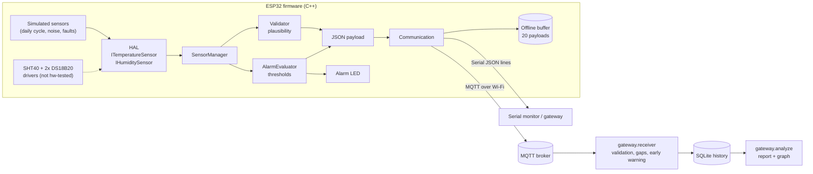

# Architecture

## Overview



## Hardware Abstraction Layer (HAL)

`include/hal/sensors.h` defines two interfaces:

```cpp
class ITemperatureSensor { virtual bool begin() = 0; virtual bool readCelsius(float&) = 0; };
class IHumiditySensor    { virtual bool begin() = 0; virtual bool readRelativeHumidity(float&) = 0; };
```

- **Units:** temperatures in °C, humidity in %RH (0–100).
- **Errors:** `false` means the driver could not read (bus error, unplugged probe, CRC). A `true` read can
  still deliver NaN or an impossible value; that is caught by `Validator`, not by the driver.
- **Implementations:** `SimulatedTemperatureSensor` / `SimulatedHumiditySensor` (default) and
  `Sht4xTemperature`, `Sht4xHumidity`, `Ds18b20Sensor` (`USE_REAL_SENSORS=1`).
- **Swapping:** only the object construction in `src/main.cpp` differs between simulation and hardware.
  `SensorManager`, validation, alarms and communication are unchanged. The native test
  `test_sensor_manager` proves this by driving `SensorManager` with hand-written fakes of the interfaces.

The simulation is deterministic (seeded xorshift noise, injectable `Clock`) so the same code can be unit
tested on a PC. It models a grow light: inside air 23.5 ± 2.5 °C, outside air 21 ± 1 °C, water 20.5 ± 0.8 °C
lagging two hours, humidity 62 ∓ 8 %RH. These numbers are assumptions for demonstration, not measured data.
Faults can be injected (read error, NaN, spike) and a heat event can be applied as an offset.

## Firmware modules

| Module | Responsibility |
|---|---|
| `SensorManager` | Reads all four channels via the HAL, numbers each reading (`seq`), sets fault/alarm masks |
| `Validator` | Plausibility guardrails: inside −10–60 °C, outside −30–60 °C, water 0–50 °C, RH 0–100 %, finite |
| `AlarmEvaluator` | Crop thresholds from `config.h` (assumptions): inside air 18–28 °C, water 18–24 °C, RH 40–80 % |
| `payload` | Portable JSON builder (snprintf); faulty channels as `null` |
| `PayloadBuffer` | Bounded FIFO for payloads that could not be published |
| `Communication` | Serial output, non-blocking Wi-Fi/MQTT reconnect, Last Will, flushing the buffer |
| `main.cpp` | Non-blocking 5 s schedule (`millis()`), LEDs, simulation buttons |

A broken sensor is a **fault**, not an alarm: a channel that failed or is implausible never raises a
threshold alarm ("too hot"), so the user is not sent the wrong message.

## Data representation

One JSON object per reading (schema 1), see README. `uptime_ms` is time since boot, not wall-clock time;
the gateway stamps `received_at` in UTC. `time_scale` tells the gateway how much faster than real time the
simulation runs so trends are computed in environment time.

## Communication choice: MQTT

MQTT was chosen because the customer wants many units connected to a future cloud service: publish/subscribe
decouples devices from consumers, topics scale per device (`microhydros/<device>/measurement`), the protocol
is light for a microcontroller and is supported by common cloud IoT services. Serial JSON is kept as a
fallback and debugging path (and is itself a valid gateway interface). HTTP/REST was not chosen because the
device would need to know the server and poll/push per request; BLE would need a nearby gateway device.

## Handling of lost data

- **On the device:** if Wi-Fi or the broker is down, payloads are kept in a RAM FIFO of 20 entries
  (100 s at the 5 s interval) and sent in order when the connection returns. If the outage is longer, the
  oldest payloads are dropped and counted. Nothing is persisted across a reboot (prototype limitation).
- **On the receiver:** `seq` increments per reading, so gaps are detected and logged as `gap` events with the
  number of lost messages; a lower `seq` is logged as a device `restart`.
- **Device presence:** Last Will publishes `offline` on the status topic if the device disappears.

## Security

The Wokwi build uses a public broker without TLS or authentication: anyone can read or publish on the
topic. Only simulated, non-sensitive data is sent. The device never subscribes to commands, so it cannot be
remote-controlled. Credentials for real networks live in `include/secrets.h`, which is ignored by Git.
For production: own broker, TLS (port 8883), per-device credentials or certificates, and payload
validation on the server (already done in `gateway.schema`).

## Measurement interval

The prototype measures every 5 s so effects are visible in a short demo. For the product we recommend
**every 30–60 s** (to be validated): the SHT40 responds in a few seconds (τ63 4 s RH, 2 s temperature) and
a DS18B20 conversion takes up to 750 ms, so the sensors are not the limit; a small enclosure changes over
minutes, which 30–60 s resolves while keeping data volume and power use low. Alarms are evaluated on every
reading.
