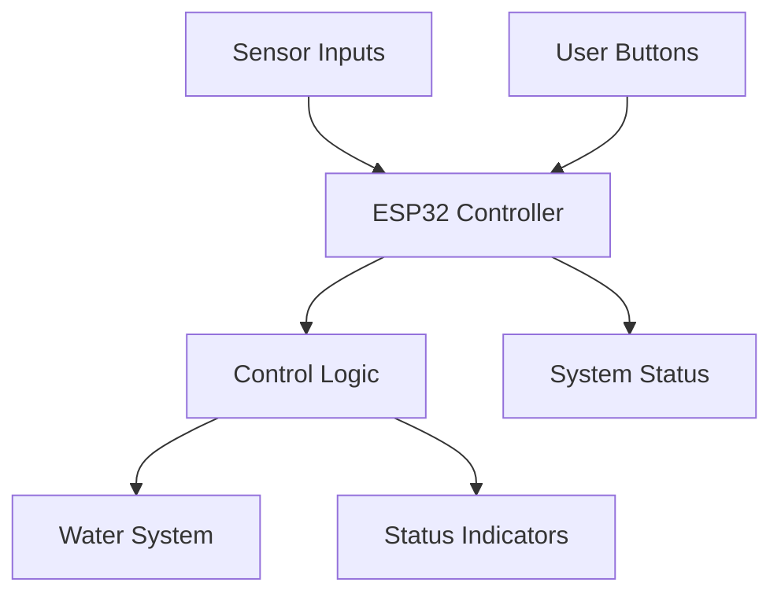

# 🌱 MicroHydros – A Greener Future, One Small Garden at a Time

**Group Project Presentation**

**Project:** MicroHydros – Hydroponic Growing System  
**Customer:** HydroGreen Fingers AB  
**Date:** November 2026

**Group Members:**
- Gayathri Jayaprakash
- Desmond
- Khaled

---

## Slide 1 – Introduction

### A Greener Future, One Small Garden at a Time

MicroHydros is a small-scale hydroponic growing system designed to make growing plants easier, smarter and more sustainable.

Our project explores how embedded systems and IoT technology can support indoor plant growing.

**Our goal:**
- Make indoor growing easier.
- Support efficient water usage.
- Use embedded technology to monitor and control the system.
- Demonstrate the functionality through simulation and testing.

**Presenter: Gayathri**

---

## Slide 2 – Project Overview

### What is MicroHydros?

MicroHydros is an IoT-based hydroponic concept.

Hydroponics means growing plants without traditional soil, using nutrient-rich water.

The system combines hardware, embedded software and testing to demonstrate the main functions.

**Main areas:**
- Embedded system development
- ESP32-based control
- Sensor inputs
- Water and growing system functionality
- Simulation and firmware testing

**Presenter: Gayathri**

---

## Slide 3 – System Architecture

### How Does the System Work?

The system uses an embedded controller to receive information, process inputs and control outputs.

**Explanation:**
1. Sensors provide information to the controller.
2. ESP32 processes the inputs.
3. Control logic decides how the system should respond.
4. Outputs represent the system's actions.
5. Buttons allow the user to interact with the system.

*Note: The diagram represents the conceptual system flow. Actual implemented connections should be verified against the project hardware and code.*

**Presenter: Gayathri**

---

## Slide 4 – Hardware and Embedded System

### Main Hardware Components

The project uses an ESP32-based embedded system.

Key areas:
- ESP32 microcontroller
- Input components and buttons
- Sensor interfaces
- Output/control components
- Power supply

The ESP32 acts as the central controller and executes the firmware.

**Presenter: Desmond**

---

## Slide 5 – Firmware and System Functionality

### How Does the Firmware Work?

The firmware is responsible for controlling the system.

Main responsibilities:
- Read input signals.
- Process user button interactions.
- Handle sensor data.
- Execute control logic.
- Update system status.
- Control the connected outputs.

The firmware connects the hardware components with the intended system behaviour.

**Presenter: Desmond**

---

## Slide 6 – Wokwi Simulation Demonstration

### Live Demonstration

We use Wokwi to demonstrate the embedded system behaviour.

**Live demonstration by Khaled:**
1. Open the Wokwi simulation.
2. Show the hardware components.
3. Press the available buttons.
4. Explain how the system responds.
5. Demonstrate the firmware behaviour.
6. Show the resulting system status.

**Presenter: Khaled**

---

## Slide 7 – Firmware Testing

### Testing and Verification

We performed **30 firmware tests** to verify the implemented functionality.

Testing focuses on:
- Button functionality
- Input handling
- Firmware logic
- Expected output behaviour
- System response
- Error handling

The purpose of testing is to verify that the firmware behaves as expected.

**Presenter: Khaled**

---

## Slide 8 – Customer Meeting and Feedback

### Meeting with Sebastian

**Customer:** Sebastian Green Öhman  
**Date:** Monday, 2 November 2026  
**Time:** 14:30  
**Platform:** Google Meet

The meeting was used to discuss the MicroHydros project and its requirements.

Customer feedback and discussions help us understand the project expectations and improve our implementation.

**Presenter: Gayathri**

---

## Slide 9 – Group Contributions

### Working Together

| Group member | Main contribution |
|---|---|
| Gayathri Jayaprakash | Project requirements, documentation and presentation |
| Desmond | Hardware and embedded system development |
| Khaled | Firmware testing and Wokwi simulation demonstration |

We worked together to develop, document, simulate and verify the project.

---

## Slide 10 – Conclusion

### What Have We Achieved?

Through this project, we have explored:
- Embedded systems development.
- ESP32-based control.
- Hardware and software integration.
- Wokwi simulation.
- Firmware testing.
- Team collaboration and documentation.

MicroHydros demonstrates how embedded technology can support smarter and more sustainable indoor growing solutions.

### Thank You!

**Questions and Discussion 🌱**